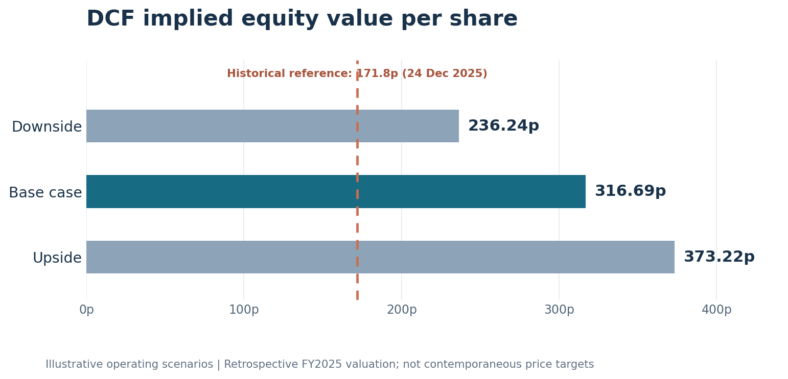

# Domino's Pizza Group plc | Discounted Cash Flow Valuation

**Independent equity valuation project | FY2025 historical base | Five-year forecast (FY2026–FY2030)**

An Excel-based fundamental valuation of Domino's Pizza Group plc (LSE: DOM), incorporating audited historical financial statements, operating forecasts, free cash flow to the firm (FCFF), weighted average cost of capital (WACC), lease-aware enterprise-to-equity adjustments, operating scenarios, sensitivity analysis and reverse DCF analysis.

**Scope and date convention:** The historical financial reporting date is **28 December 2025**. The historical quoted share-price comparator is **171.8p on 24 December 2025**. This is a **retrospective** valuation built using audited FY2025 financial disclosures published after that share-price reference; it is **not** a contemporaneous December 2025 investment recommendation or a backtest using information available at the time.

## Principal findings

| Metric | Base case |
|---|---:|
| Indicated equity value per share | **316.69p** |
| Enterprise value | £1,531.37m |
| Equity value | £1,207.07m |
| WACC | 7.31% |
| Long-term FCFF growth | 2.00% |
| Shares excluding employee benefit trust (EBT) | 381.158m |
| Discounted terminal value / enterprise value | 78.7% |
| Historical December 2025 quoted price | 171.8p |
| Indicated premium to historical reference | 84.3% |

### Operating scenarios

| Scenario | Indicative share value | Primary operating changes versus base |
|---|---:|---|
| Downside | **236.24p** | System-sales growth −1.0 percentage point annually; EBIT margin −0.75 pp; CapEx/revenue +1.0 pp; additional annual NWC cash use/revenue +0.2 pp |
| Base | **316.69p** | Selected operating forecast, no scenario shocks |
| Upside | **373.22p** | System-sales growth +1.0 percentage point annually; EBIT margin +0.50 pp; CapEx/revenue −0.50 pp; additional annual NWC cash use/revenue −0.1 pp |

All scenarios are formula-driven and retain the selected WACC and terminal growth assumptions. They are illustrative valuation cases, not probability-weighted price targets or independent forecasts.

*Source: `dominos_dcf.xlsx`. Values are model-implied; the historical reference predates release of the FY2025 audited accounts.*

## Business and valuation rationale

Domino's Pizza Group operates a predominantly franchised pizza delivery and collection network in the UK and Ireland. Its economics depend on franchisee store-level activity and growth, royalties and supply-chain revenues, network efficiency and the capital required to support operations. System sales and reported group revenue are not interchangeable.

The model forecasts operating cash generation over FY2026–FY2030 and values **FCFF** using a perpetual-growth discounted cash flow approach:

`Enterprise value = Σ[FCFF_t / (1 + WACC)^t] + [FCFF_2031 / (WACC − g)] / (1 + WACC)^5`

`Equity value = enterprise value − borrowings + cash − head-lease liabilities + finance sublease receivables`

`Value per share (pence) = equity value (£m) / shares excluding EBT (m) × 100`

The lease treatment aims to avoid omitting head-lease financing obligations while recognising relevant finance sublease assets. Historical operating cash flow minus cash CapEx is **not** treated as interchangeable with FCFF.

### Selected forecast assumptions

- **Forecast horizon:** FY2026–FY2030; thereafter, 2.00% perpetual growth.
- **Cost of capital:** 7.31% WACC, incorporating a 4.51% UK gilt proxy, an approximately 1.00 historical regression beta, a 5.0% assumed equity risk premium, and modelled borrowing/lease financing costs. This is an analyst-selected cost-of-capital estimate.
- **Tax:** 25% marginal operating tax assumption.
- **Operating drivers:** network store additions, like-for-like system-sales growth, reported-revenue conversion and operating EBIT margin assumptions.
- **CapEx:** FY2026–FY2030 cash CapEx as a share of revenue of 5.00%, 4.50%, 4.25%, 4.00% and 4.00%, respectively. Long-run reinvestment and lease-renewal economics remain key judgements.
- **Terminal value:** based on FY2031 FCFF and constant perpetual growth rather than an exit multiple.

## Interpreting the market-price difference

The 316.69p base case is 84.3% above the 171.8p **historical** reference. This gap is a result of the model's cash flow, financing, reinvestment and terminal assumptions, not proof that the historical market was incorrect. Importantly, the model uses information released after the reference price and therefore must not be framed as an investable contemporaneous signal.

An illustrative reverse DCF, holding explicit-period FCFF, WACC and perpetual growth unchanged, implies roughly **£49.30m FY2031 terminal FCFF** at the reference price, versus **£90.99m** in the selected base case. This isolates an important source of disagreement; it does not uniquely recover market expectations.

## Sensitivities and limitations

- **Terminal dependence:** roughly 78.7% of enterprise value is attributable to the discounted terminal value. Terminal FCFF sustainability is the principal economic uncertainty.
- **WACC:** small changes in beta, equity risk premium or future refinancing costs can materially change valuation.
- **Lease/sublease accounting:** head leases, related finance sublease receivables and lease-renewal investment require consistent cash flow and equity-bridge treatment.
- **Sustainable CapEx:** future maintenance, infrastructure and digital reinvestment may differ from modelled revenue percentages.
- **Forecast architecture:** forward borrowings, future lease renewals and terminal cash-flow sustainability are simplified rather than independently verified; this is **not** a fully detailed IFRS three-statement forecast.
- **Market comparison:** historical price predates the FY2025 audited report, creating hindsight/information-timing limitations.

## Workbook structure

The Excel model contains **six worksheets**:

1. `Assumptions` — historical reference points, operating drivers, WACC build, sourcing notes and validation controls.
2. `Income Statement` — historical and forecast income statement calculations.
3. `Balance Sheet` — historical and simplified forecast balance sheet with reconciliation checks.
4. `Cash Flow` — historical and forecast cash flow schedules.
5. `DCF` — FCFF, discounting, terminal value, and enterprise-to-equity bridge.
6. `Sensitivity` — WACC/terminal-growth matrix, live operating scenarios and reverse DCF.

## Sources and reproducibility

The main historical source set comprises **Domino's Pizza Group annual reports FY2021–FY2025**, particularly the **FY2025 audited consolidated statements and notes** covering revenue, finance, borrowings, head leases, finance subleases and issued/EBT-held shares. Historical share prices and market inputs (including equity beta and gilt proxy) are documented on the `Assumptions` worksheet, together with analyst assumptions. The financial model distinguishes audited data from derived forecasts and proxies.

Open `dominos_dcf.xlsx` in Microsoft Excel and recalculate formulas. Edit the clearly identified scenario inputs on `Assumptions` to inspect changes in `Sensitivity`, or adjust WACC and perpetual growth to analyse valuation sensitivity. The model is designed for transparency rather than automated live-market updates.

## Files

- [`dominos_dcf.xlsx`](dominos_dcf.xlsx) — audited six-sheet financial model.
- [`VALUATION_SUMMARY.md`](VALUATION_SUMMARY.md) — concise valuation interpretation, key risks and conclusions.

## Project scope

This is an **independent educational portfolio analysis**, not investment advice or a company-sponsored project. Model arithmetic and material formula links have been reviewed; the projections, risk premia, operating cases and terminal assumptions remain judgements, not externally verified outcomes.
